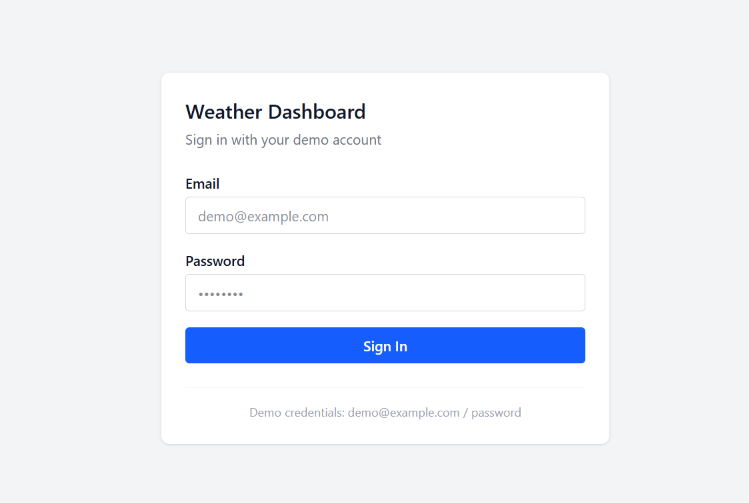
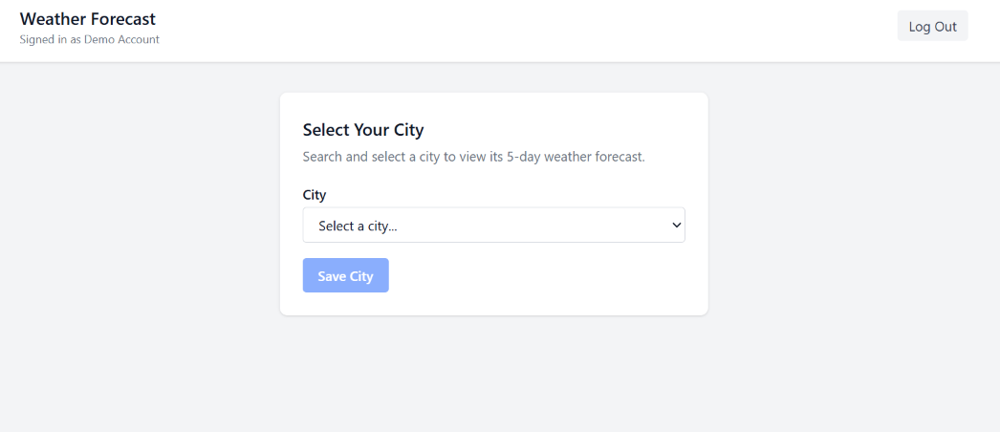
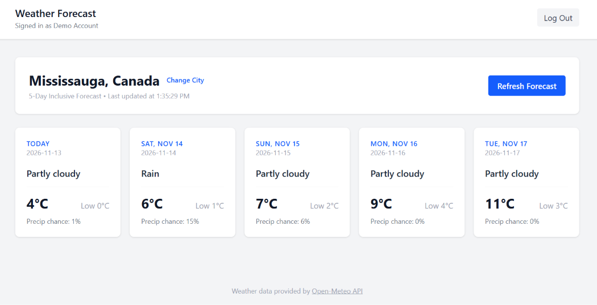

# Personalized Weather Forecast Dashboard

A full-stack weather forecasting web application built with **Laravel**, **Inertia.js**, **React**, and **Tailwind CSS**, powered by the **Open-Meteo API**.

## Features
- **Session Authentication:** Prepopulated demo accounts with protected dashboard routes.
- **First-Time Onboarding:** Prompts new users to select their preferred city upon initial login.
- **5-Day Inclusive Forecast:** Displays daily weather conditions, high/low temperatures (°C), and precipitation probability.
- **Persistent Preferences:** Saves the user's selected location and coordinates in MySQL across sessions.
- **On-Demand Updates:** Supports instant forecast refreshes (updating database timestamps) and switching cities anytime.

## Tech Stack
- **Backend:** PHP 8.5, Laravel 13
- **Frontend:** React, Inertia.js, Tailwind CSS, Vite
- **Database:** MySQL 8.4
- **Containerization:** Docker (Laravel Sail)
- **External API:** Open-Meteo Forecast API (no API key required)

## Screenshots

### 1. Login Screen


### 2. City Selection


### 3. 5-Day Weather Forecast Dashboard


## Demo Credentials
The database seeder creates two test profiles to demonstrate both first-time onboarding and returning user persistence:

| Account Type | Email | Password | Initial State |
| :--- | :--- | :--- | :--- |
| **First-Time User** | `demo@example.com` | `password` | No city selected (triggers city selection prompt) |
| **Returning User** | `janki@example.com` | `password` | Pre-configured with `Toronto, Canada` |

## Local Setup Instructions

1. **Clone the repository and configure environment variables:**
   ```bash
   git clone https://github.com
   cd weather-app
   cp .env.example .env
   ```

2. **Install PHP dependencies via Composer:**
   ```bash
   docker run --rm -v \$(pwd):/app -w /app composer install
   ```

3. **Start the Docker containers:**
   ```bash
   ./vendor/bin/sail up -d
   ```

4. **Generate the application key, run migrations, and seed demo users:**
   ```bash
   ./vendor/bin/sail artisan key:generate
   ./vendor/bin/sail artisan migrate:fresh --seed
   ```

5. **Install frontend dependencies and build assets:**
   ```bash
   ./vendor/bin/sail npm install
   ./vendor/bin/sail npm run build
   ```

6. **Open the application:**
   Visit `http://localhost` in your browser and sign in with the demo credentials above.

---
Weather data provided by the [Open-Meteo API](https://open-meteo.com).
